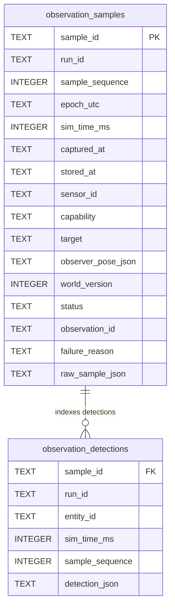

# Observation Ledger and Temporal Retrieval (P2-04)

- **Issue:** [#24: [P2-04] Persist sampled observations and add run-scoped temporal evidence queries](https://github.com/dhruvkshah75/groundtruth/issues/24)
- **Pull Request:** [#39: feat(p2-04): persist sampled observations and add temporal evidence queries](https://github.com/dhruvkshah75/groundtruth/pull/39)
- **Branch:** `p204`
- **Lane:** Temporal Memory (Member B)
- **Status:** Complete (M1 Foundation)
- **Prerequisites:**
  - Issue [#21](https://github.com/dhruvkshah75/groundtruth/issues/21) Contracts (`src/contracts/simulation.py`): `ObservationSample`, `SensorObservation`, `ObservationUnavailable`, `CameraScan`, `CameraDetection`, `TemporalObservationQuery`, `ObservationLedgerReader`, `ObservationLedgerWriter`, `ObservationLedger`.
  - Tier 1 Declarative Persistence (`src/declarative/schema.py`, `src/declarative/memory_repository.py`).

---

## 1. Overview and System Context

The **Observation Ledger** provides additive, durable persistence and run-scoped temporal querying for raw sensor evidence acquired during simulation runs.

In GroundTruth's three-tier epistemic architecture:
- **Tier 3 (Sensors):** Produces `ObservationSample` envelopes capturing what sensors actually sampled (including successful detections, empty scans, and outages).
- **Tier 1 (Observation Ledger in `MemoryRepository`):** Persists raw samples and indexed entity detections in SQLite without creating facts, revisions, audit trails, or graph edges.
- **Tier 2 (Epistemic Logic):** Downstream consumer that inspects chronological evidence and sightings to make belief revision decisions (P2-05), answer temporal queries (P2-08), and evaluate playback replay (P2-12).

### Raw Evidence vs. Active Belief Facts
Raw sensor samples are **fundamentally distinct** from belief facts:
1. An empty camera scan or temporary sensor outage is valid sensor evidence, but does not prove an entity ceased to exist or moved.
2. Samples are stored with both simulation capture time (`sim_time_ms`, integer milliseconds) and repository storage time (`stored_at`, UTC datetime).
3. Storing observations never modifies the active knowledge graph or triggers belief revision listeners.

---

## 2. Architecture and Database Schema

The ledger extends SQLite in `src/declarative/schema.py` via idempotent `CREATE TABLE IF NOT EXISTS` statements.



### Tables and Indexes
1. **`observation_samples`:**
   - One row per acquisition attempt (`sample_id` PRIMARY KEY).
   - Captures metadata (`run_id`, `sample_sequence`, `epoch_utc`, `sim_time_ms`, `captured_at`, `stored_at`).
   - Retains capability, optional target, observer pose JSON, world version, status (`success` or `unavailable`), observation ID, failure reason, and canonical `raw_sample_json`.
   - **Indexes:**
     - `idx_obs_run_capability_sim_time ON observation_samples(run_id, capability, sim_time_ms, sample_sequence)`
     - `idx_obs_run_sim_time ON observation_samples(run_id, sim_time_ms, sample_sequence)`

2. **`observation_detections`:**
   - Normalized detection index for multi-object camera scans.
   - `PRIMARY KEY (sample_id, entity_id)` with `FOREIGN KEY (sample_id) REFERENCES observation_samples(sample_id) ON DELETE CASCADE`.
   - Allows $O(1)$ and range lookups for sightings of any detected entity without parsing JSON payloads or duplicating parent samples.
   - **Indexes:**
     - `idx_obs_detections_run_entity_time ON observation_detections(run_id, entity_id, sim_time_ms, sample_sequence)`

### Pre-Validation of Detached Payloads & Atomicity
- **Detached Payload Pre-Validation:** `ObservationSample` instances and nested Pydantic models are mutable. In `record_observation_sample()`, the incoming sample is dumped to a JSON-serialized dict and immediately revalidated via `ObservationSample.model_validate(detached_data)` and `StoredObservationSample.model_validate(...)` *before* any SQLite statements execute. This guarantees that mutated or corrupt envelopes are rejected with `ValidationError` and never leave partial or invalid rows in the database.
- **Canonical Idempotence:** Re-inserting an `ObservationSample` with an existing `sample_id` and identical canonical content returns the original `StoredObservationSample` (including original `stored_at`) without inserting duplicate rows.
- **Conflict Rejection:** Reusing a `sample_id` with different content immediately raises `ValueError` and leaves the database unmutated.
- **Atomic Transactions:** Parent samples and detection associations are written within a single `with self._conn:` transaction. If any error occurs, both parent and child tables roll back completely.

### External Session-Lock Serialization
`MemoryRepository` manages an SQLite connection created with `check_same_thread=False` to support asynchronous event loop turn processing in web contexts. While internal repository operations run within SQLite transactions to maintain relational integrity, thread-safety and race condition prevention for concurrent writes or interleaved turns are handled externally via session-level locks (e.g., in `SessionStore` / `AgentSession` mutexes). The repository assumes a single active transaction per session at any moment.

---

## 3. Public API & Protocols

Defined in `src/contracts/simulation.py` and exported from `src/contracts/__init__.py` and `src/declarative/__init__.py`:

```python
class StoredObservationSample(ObservationSample):
    """An ObservationSample stored in Tier 1 SQLite with its storage UTC timestamp."""

    stored_at: datetime
```

### Protocols

```python
@runtime_checkable
class ObservationLedgerReader(Protocol):
    def get_observation_sample(self, sample_id: UUID) -> StoredObservationSample | None: ...
    def query_observations(
        self, query: TemporalObservationQuery
    ) -> list[StoredObservationSample]: ...
    def get_latest_sample(
        self,
        run_id: UUID,
        capability: str,
        sensor_id: str | None = None,
        entity_id: str | None = None,
        start_ms: int | None = None,
        at_sim_time_ms: int | None = None,
    ) -> StoredObservationSample | None: ...
    def get_last_sighting(
        self,
        run_id: UUID,
        entity_id: str,
        capability: str | None = None,
        sensor_id: str | None = None,
        start_ms: int | None = None,
        at_sim_time_ms: int | None = None,
    ) -> StoredObservationSample | None: ...
    def get_entity_sighting_history(
        self,
        run_id: UUID,
        entity_id: str,
        capability: str | None = None,
        sensor_id: str | None = None,
        start_ms: int | None = None,
        end_ms: int | None = None,
        limit: int = 100,
    ) -> list[StoredObservationSample]: ...


@runtime_checkable
class ObservationLedgerWriter(Protocol):
    def record_observation_sample(self, sample: ObservationSample) -> StoredObservationSample: ...


@runtime_checkable
class ObservationLedger(ObservationLedgerReader, ObservationLedgerWriter, Protocol): ...
```

Tier 2 procedural logic consumes this ledger strictly via `ObservationLedgerReader` without importing or interacting with SQLite, raw SQL, or `sqlite3.Row`.

`MemoryRepository.query_samples()` is a concrete repository convenience method, not part of `ObservationLedgerReader`. Protocol consumers use `query_observations(TemporalObservationQuery(mode="samples", run_id=...))` for the same retrieval, including optional capability, sensor, entity and inclusive time filters.

---

## 4. Timing & Query Semantics

### Capture-Time Retrieval vs. Historical Reception-Time Reconstruction
1. **Capture-Time Retrieval Among Stored Samples (`sim_time_ms`):**
   - GroundTruth simulation operates on an explicit simulation clock starting at `epoch_utc`, advancing in integer milliseconds (`sim_time_ms`).
   - All temporal ledger queries (`get_latest_sample`, `get_last_sighting`, `query_samples`, `TemporalObservationQuery`) evaluate the simulation capture timeline among the stored set of samples (`sim_time_ms <= at_sim_time_ms`).
   - Slower presenter playback rates (0.25×, 0.5×, 1×) scale wall-clock scheduling only and do not alter stored `sim_time_ms` or query outcomes.
   - Late-delivered samples (e.g., simulated network packet delay where a sample from $t=500$ arrives after $t=1500$) are indexed into their correct chronological slot in simulation time. Subsequent queries for the state at $t=600$ will see the $t=500$ sample.
2. **Historical Reception-Time Reconstruction (`stored_at`):**
   - The ledger immutably records the wall-clock UTC arrival timestamp (`stored_at`) for every sample to provide complete auditability.
   - The ledger does **not** implement bi-temporal point-in-time database reconstruction (i.e., reconstructing what the database state was at wall-clock 12:05 PM before a late packet was written). Late evidence immediately updates the known chronological timeline for subsequent queries; downstream epistemic belief revision (P2-05) is responsible for handling any belief state updates triggered by newly arrived historical evidence.

### Ordering, Ties, and Boundaries
1. **Deterministic Tie-Breaking:**
   - Samples sharing the same `sim_time_ms` break ties deterministically:
     `ORDER BY sim_time_ms ASC/DESC, sample_sequence ASC/DESC, sample_id ASC/DESC`.
2. **Inclusive Boundaries:**
   - Interval queries (`start_ms` to `end_ms`) are inclusive on both ends (`sim_time_ms >= start_ms AND sim_time_ms <= end_ms`).
   - "At-time" queries retrieve evidence captured at or before the specified time (`sim_time_ms <= at_sim_time_ms`).
3. **Positive Sightings vs. Status Scans:**
   - `get_last_sighting` queries positive sightings in `observation_detections`. A later empty scan ($t=3000$) or outage ($t=4000$) does not erase an earlier positive sighting ($t=2000$).
   - `get_latest_sample` queries the parent sensor status regardless of detections.

---

## 5. Runnable Usage & Downstream Handoff Example

The following self-contained four-stage example demonstrates storing evidence across two distinct observation poses, an empty scan, and an outage, followed by verifying queries and assertions:

```python
from datetime import UTC, datetime, timedelta
from uuid import uuid4

from src.contracts import (
    CameraDetection,
    CameraScan,
    ObservationRequest,
    ObservationSample,
    ObservationUnavailable,
    Point,
    Pose,
    SensorObservation,
    SpatialContext,
    TemporalObservationQuery,
)
from src.declarative import MemoryRepository

repo = MemoryRepository()
run_id = uuid4()
epoch = datetime(2026, 11, 5, 12, 0, 0, tzinfo=UTC)

pose_st1 = Pose(
    robot_id="robot_01",
    x_cm=100.0,
    y_cm=100.0,
    direction="north",
    location="dock",
    frame_of_reference="warehouse_map",
)
pose_st2 = Pose(
    robot_id="robot_01",
    x_cm=300.0,
    y_cm=300.0,
    direction="east",
    location="dock",
    frame_of_reference="warehouse_map",
)

det_st1 = CameraDetection(
    object_id="parcel_handoff",
    apparent_color="cardboard_brown",
    position=Point(x_cm=120.0, y_cm=220.0),
    frame_of_reference="warehouse_map",
    bounding_box={"width_cm": 40.0, "height_cm": 30.0},
)

det_st2 = CameraDetection(
    object_id="parcel_handoff",
    apparent_color="cardboard_brown",
    position=Point(x_cm=320.0, y_cm=320.0),
    frame_of_reference="warehouse_map",
    bounding_box={"width_cm": 40.0, "height_cm": 30.0},
)

# Stage 1: Sighting at station 1 (t=1000)
sample_1 = ObservationSample(
    sample_id=uuid4(),
    run_id=run_id,
    sample_sequence=1,
    epoch_utc=epoch,
    sim_time_ms=1000,
    captured_at=epoch + timedelta(milliseconds=1000),
    sensor_id="camera_detect",
    observer_pose=pose_st1,
    world_version=1,
    request=ObservationRequest(capability="camera_detect"),
    result=SensorObservation(
        observation_id=uuid4(),
        sensor="camera_detect",
        capability="camera_detect",
        observed_at=epoch + timedelta(milliseconds=1000),
        confidence_score=1.0,
        context=SpatialContext(
            observer="robot_01",
            location="dock",
            frame_of_reference="warehouse_map",
            world_version=1,
        ),
        measurements=CameraScan(objects=[det_st1]).model_dump(mode="json"),
    ),
)
repo.record_observation_sample(sample_1)

# Stage 2: Sighting at station 2 (t=2000)
sample_2 = ObservationSample(
    sample_id=uuid4(),
    run_id=run_id,
    sample_sequence=2,
    epoch_utc=epoch,
    sim_time_ms=2000,
    captured_at=epoch + timedelta(milliseconds=2000),
    sensor_id="camera_detect",
    observer_pose=pose_st2,
    world_version=1,
    request=ObservationRequest(capability="camera_detect"),
    result=SensorObservation(
        observation_id=uuid4(),
        sensor="camera_detect",
        capability="camera_detect",
        observed_at=epoch + timedelta(milliseconds=2000),
        confidence_score=1.0,
        context=SpatialContext(
            observer="robot_01",
            location="dock",
            frame_of_reference="warehouse_map",
            world_version=1,
        ),
        measurements=CameraScan(objects=[det_st2]).model_dump(mode="json"),
    ),
)
repo.record_observation_sample(sample_2)

# Stage 3: Empty scan at t=3000
sample_3 = ObservationSample(
    sample_id=uuid4(),
    run_id=run_id,
    sample_sequence=3,
    epoch_utc=epoch,
    sim_time_ms=3000,
    captured_at=epoch + timedelta(milliseconds=3000),
    sensor_id="camera_detect",
    observer_pose=pose_st2,
    world_version=1,
    request=ObservationRequest(capability="camera_detect"),
    result=SensorObservation(
        observation_id=uuid4(),
        sensor="camera_detect",
        capability="camera_detect",
        observed_at=epoch + timedelta(milliseconds=3000),
        confidence_score=1.0,
        context=SpatialContext(
            observer="robot_01",
            location="dock",
            frame_of_reference="warehouse_map",
            world_version=1,
        ),
        measurements=CameraScan(objects=[]).model_dump(mode="json"),
    ),
)
repo.record_observation_sample(sample_3)

# Stage 4: Outage at t=4000
sample_4 = ObservationSample(
    sample_id=uuid4(),
    run_id=run_id,
    sample_sequence=4,
    epoch_utc=epoch,
    sim_time_ms=4000,
    captured_at=epoch + timedelta(milliseconds=4000),
    sensor_id="camera_detect",
    observer_pose=pose_st2,
    world_version=1,
    request=ObservationRequest(capability="camera_detect"),
    result=ObservationUnavailable(
        capability="camera_detect",
        reason="sensor_unavailable",
        reported_at=epoch + timedelta(milliseconds=4000),
        message="Observation unavailable.",
    ),
)
repo.record_observation_sample(sample_4)

# Assertions and Query Outputs:
# A. Last sighting: returns sample_2 from station 2 at t=2000 despite later empty scan and outage
last_sighting = repo.get_last_sighting(run_id, "parcel_handoff")
assert last_sighting is not None
assert last_sighting.sample_id == sample_2.sample_id
assert last_sighting.sim_time_ms == 2000
assert last_sighting.observer_pose.x_cm == 300.0

# B. Chronological sighting history: returns both positive sightings in order
history = repo.get_entity_sighting_history(run_id, "parcel_handoff")
assert len(history) == 2
assert [s.sample_id for s in history] == [sample_1.sample_id, sample_2.sample_id]
assert [s.sim_time_ms for s in history] == [1000, 2000]

# C. Latest sensor status: returns outage sample_4 at t=4000
latest_status = repo.get_latest_sample(run_id, "camera_detect")
assert latest_status is not None
assert latest_status.sample_id == sample_4.sample_id
assert latest_status.sim_time_ms == 4000
assert isinstance(latest_status.result, ObservationUnavailable)
assert latest_status.result.reason == "sensor_unavailable"

# D. TemporalObservationQuery protocol dispatch:
dispatch_last = repo.query_observations(
    TemporalObservationQuery(
        run_id=run_id,
        mode="last_seen",
        entity_id="parcel_handoff",
    )
)
assert len(dispatch_last) == 1
assert dispatch_last[0].sample_id == sample_2.sample_id
```

---

## 6. Backward Compatibility & Snapshots

- **Legacy Database Migration:** Opening an older on-disk SQLite database or calling `initialize_schema()` additively creates `observation_samples` and `observation_detections` without affecting existing `facts`, `audit_events`, or `aliases`.
- **Deserialized Snapshot Upgrades:** `restore_snapshot()` in `MemoryRepository` explicitly executes `initialize_schema(self._conn)` immediately after `deserialize(image)`, ensuring legacy snapshots receive observation tables upon restore without deleting chat session databases.
- **Export Integrity:** `export_snapshot()` serializes the entire SQLite database image including all recorded observation samples and detection indices.

---

## 7. Verification & Checkpoint Results

All tests run deterministically with zero network, LLM, or wall-clock dependencies:

```bash
# 1. Targeted observation ledger test suite (including regression tests)
uv run --locked pytest tests/unit/declarative/test_observation_ledger.py -v
# Output: 20 passed in 2.15s

# 2. Full test suite regression check
uv run --locked pytest -q
# Output: 472 passed in 10.42s

# 3. Code formatting and style
uv run --locked ruff check .
# Output: All checks passed!

uv run --locked ruff format --check .
# Output: 120 files already formatted
```

---

## 8. Downstream Integration

- **P2-05 (Temporal Belief Ingestion - #27):** Reads latest positive sightings and camera status to apply freshness decay and determine whether to assert/revise belief facts in Tier 1.
- **P2-08 (Temporal Questions - #32):** Queries sighting histories and timestamps to answer natural language questions about when objects were moved or seen.
- **P2-12 (Evaluation & Replay - #36):** Uses exported observation envelopes to replay sensor events deterministically.
