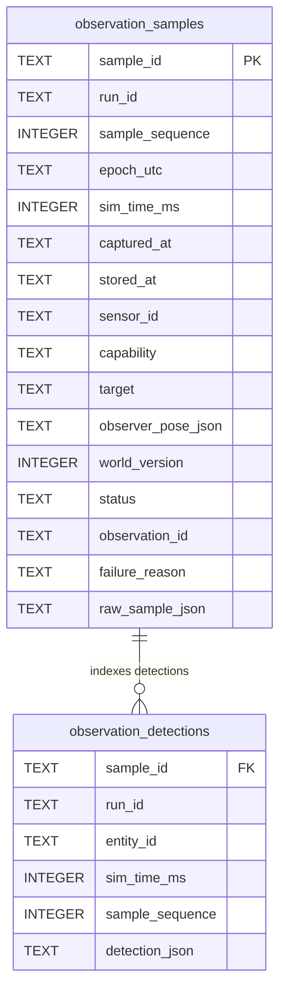

# Observation Ledger and Temporal Retrieval (P2-04)

- **Issue:** [#24: [P2-04] Persist sampled observations and add run-scoped temporal evidence queries](https://github.com/dhruvkshah75/groundtruth/issues/24)
- **Branch:** `p204`
- **Lane:** Temporal Memory (Member B)
- **Status:** Complete (M1 Foundation)

---

## 1. Overview and System Context

The **Observation Ledger** provides additive, durable persistence and run-scoped temporal querying for raw sensor evidence acquired during simulation runs.

In GroundTruth's three-tier epistemic architecture:
- **Tier 3 (Sensors):** Produces `ObservationSample` envelopes capturing what sensors actually sampled (including successful detections, empty scans, and outages).
- **Tier 1 (Observation Ledger in `MemoryRepository`):** Persists raw samples and indexed entity detections in SQLite without creating facts, revisions, audit trails, or graph edges.
- **Tier 2 (Epistemic Logic):** Downstream consumer that inspects chronological evidence and sightings to make belief revision decisions (P2-05), answer temporal queries (P2-08), and evaluate playback replay (P2-12).

### Raw Evidence vs. Active Belief Facts
Raw sensor samples are **fundamentally distinct** from belief facts:
1. An empty camera scan or temporary sensor outage is valid sensor evidence, but does not prove an entity ceased to exist or moved.
2. Samples are stored with both simulation capture time (`sim_time_ms`, integer milliseconds) and repository storage time (`stored_at`, UTC datetime).
3. Storing observations never modifies the active knowledge graph or triggers belief revision listeners.

---

## 2. Architecture and Database Schema

The ledger extends SQLite in `src/declarative/schema.py` via idempotent `CREATE TABLE IF NOT EXISTS` statements.



### Tables and Indexes
1. **`observation_samples`:**
   - One row per acquisition attempt (`sample_id` PRIMARY KEY).
   - Captures metadata (`run_id`, `sample_sequence`, `epoch_utc`, `sim_time_ms`, `captured_at`, `stored_at`).
   - Retains capability, optional target, observer pose JSON, world version, status (`success` or `unavailable`), observation ID, failure reason, and canonical `raw_sample_json`.
   - **Indexes:**
     - `idx_obs_run_capability_sim_time ON observation_samples(run_id, capability, sim_time_ms, sample_sequence)`
     - `idx_obs_run_sim_time ON observation_samples(run_id, sim_time_ms, sample_sequence)`

2. **`observation_detections`:**
   - Normalized detection index for multi-object camera scans.
   - `PRIMARY KEY (sample_id, entity_id)` with `FOREIGN KEY (sample_id) REFERENCES observation_samples(sample_id) ON DELETE CASCADE`.
   - Allows $O(1)$ and range lookups for sightings of any detected entity without parsing JSON payloads or duplicating parent samples.
   - **Indexes:**
     - `idx_obs_detections_run_entity_time ON observation_detections(run_id, entity_id, sim_time_ms, sample_sequence)`

### Idempotence and Atomicity
- **Canonical Idempotence:** Re-inserting an `ObservationSample` with an existing `sample_id` and identical canonical content returns the original `StoredObservationSample` (including original `stored_at`) without inserting duplicate rows.
- **Conflict Rejection:** Reusing a `sample_id` with different content immediately raises `ValueError` and leaves the database unmutated.
- **Atomic Transactions:** Parent samples and detection associations are written within a single `with self._conn:` transaction. If any part fails, both tables roll back completely.

---

## 3. Public API & Protocols

Defined in `src/contracts/simulation.py` and exported from `src/contracts/__init__.py` and `src/declarative/__init__.py`:

```python
class StoredObservationSample(ObservationSample):
    """An ObservationSample stored in Tier 1 SQLite with its storage UTC timestamp."""

    stored_at: datetime
```

### Protocols

```python
@runtime_checkable
class ObservationLedgerReader(Protocol):
    def get_observation_sample(self, sample_id: UUID) -> StoredObservationSample | None: ...
    def query_observations(
        self, query: TemporalObservationQuery
    ) -> list[StoredObservationSample]: ...
    def get_latest_sample(
        self, run_id: UUID, capability: str, at_sim_time_ms: int | None = None
    ) -> StoredObservationSample | None: ...
    def get_last_sighting(
        self, run_id: UUID, entity_id: str, at_sim_time_ms: int | None = None
    ) -> StoredObservationSample | None: ...
    def get_entity_sighting_history(
        self,
        run_id: UUID,
        entity_id: str,
        start_ms: int | None = None,
        end_ms: int | None = None,
        limit: int = 100,
    ) -> list[StoredObservationSample]: ...


@runtime_checkable
class ObservationLedgerWriter(Protocol):
    def record_observation_sample(self, sample: ObservationSample) -> StoredObservationSample: ...


@runtime_checkable
class ObservationLedger(ObservationLedgerReader, ObservationLedgerWriter, Protocol): ...
```

Tier 2 procedural logic can consume this ledger strictly via `ObservationLedgerReader` without importing or interacting with SQLite, raw SQL, or `sqlite3.Row`.

---

## 4. Timing & Query Semantics

1. **Simulation Capture Time vs. Storage Time:**
   - Physical ordering is governed by `sim_time_ms`, **never** database insertion order or wall-clock storage time (`stored_at`).
   - Slower presenter playback rates (0.25×, 0.5×, 1×) scale wall-clock scheduling only and do not alter stored `sim_time_ms` or query outcomes.

2. **Late-Delivered Samples:**
   - A delayed sample from $t=500$ inserted into the database after a sample from $t=1500$ is safely stored, but queries for the "latest" sample correctly return the sample from $t=1500$.

3. **Deterministic Tie-Breaking:**
   - Samples sharing the same `sim_time_ms` break ties using `sample_sequence`, then `sample_id`:
     `ORDER BY sim_time_ms ASC/DESC, sample_sequence ASC/DESC, sample_id ASC/DESC`.

4. **Inclusive Boundaries:**
   - Interval queries (`start_ms` to `end_ms`) are inclusive on both ends (`sim_time_ms >= start_ms AND sim_time_ms <= end_ms`).
   - "At-time" queries retrieve evidence captured at or before the specified time (`sim_time_ms <= at_sim_time_ms`).

5. **Positive Sightings vs. Status Scans:**
   - `get_last_sighting` queries positive sightings in `observation_detections`. A later empty scan ($t=1500$) or outage ($t=2000$) does not erase an earlier positive sighting ($t=1000$).
   - `get_latest_sample` queries the parent sensor status regardless of detections.

---

## 5. Runnable Usage & Downstream Handoff Example

```python
from datetime import UTC, datetime
from uuid import uuid4
from src.contracts import (
    CameraDetection,
    CameraScan,
    ObservationRequest,
    ObservationSample,
    ObservationUnavailable,
    Point,
    Pose,
    SensorObservation,
    SpatialContext,
)
from src.declarative import MemoryRepository

repo = MemoryRepository()
run_id = uuid4()
epoch = datetime(2026, 11, 5, 12, 0, 0, tzinfo=UTC)

pose_st1 = Pose(
    robot_id="robot_01",
    x_cm=100.0,
    y_cm=100.0,
    direction="north",
    location="dock",
    frame_of_reference="warehouse_map",
)
pose_st2 = Pose(
    robot_id="robot_01",
    x_cm=300.0,
    y_cm=300.0,
    direction="east",
    location="dock",
    frame_of_reference="warehouse_map",
)

det = CameraDetection(
    object_id="parcel_handoff",
    apparent_color="cardboard_brown",
    position=Point(x_cm=120.0, y_cm=220.0),
    frame_of_reference="warehouse_map",
    bounding_box={"width_cm": 40.0, "height_cm": 30.0},
)

# 1. Sighting at station 1 (t=1000)
sample_1 = ObservationSample(
    sample_id=uuid4(),
    run_id=run_id,
    sample_sequence=1,
    epoch_utc=epoch,
    sim_time_ms=1000,
    captured_at=epoch + datetime.timedelta(milliseconds=1000),
    sensor_id="camera_detect",
    observer_pose=pose_st1,
    world_version=1,
    request=ObservationRequest(capability="camera_detect"),
    result=SensorObservation(
        observation_id=uuid4(),
        sensor="camera_detect",
        capability="camera_detect",
        observed_at=epoch + datetime.timedelta(milliseconds=1000),
        confidence_score=1.0,
        context=SpatialContext(
            observer="robot_01",
            location="dock",
            frame_of_reference="warehouse_map",
            world_version=1,
        ),
        measurements=CameraScan(objects=[det]).model_dump(mode="json"),
    ),
)
repo.record_observation_sample(sample_1)

# 2. Sighting at station 2 (t=2000)
# (Same parcel observed from station 2 at t=2000)
...

# 3. Empty scan at t=3000
# 4. Outage at t=4000 (ObservationUnavailable)

# Downstream queries:
last_seen = repo.get_last_sighting(run_id, "parcel_handoff")
# Returns station 2 sighting at t=2000

history = repo.get_entity_sighting_history(run_id, "parcel_handoff")
# Returns [sample_1 (t=1000), sample_2 (t=2000)]

latest_status = repo.get_latest_sample(run_id, "camera_detect")
# Returns outage sample at t=4000
```

---

## 6. Backward Compatibility & Snapshots

- **Legacy Database Migration:** Opening an older on-disk SQLite database or calling `initialize_schema()` additively creates `observation_samples` and `observation_detections` without affecting existing `facts`, `audit_events`, or `aliases`.
- **Deserialized Snapshot Upgrades:** `restore_snapshot()` in `MemoryRepository` explicitly executes `initialize_schema(self._conn)` immediately after `deserialize(image)`, ensuring legacy snapshots receive observation tables upon restore without deleting chat session databases.
- **Export Integrity:** `export_snapshot()` serializes the entire SQLite database image including all recorded observation samples and detection indices.

---

## 7. Verification & Checkpoint Results

All tests run deterministically with zero network, LLM, or wall-clock dependencies:

```bash
# 1. Targeted observation ledger test suite
uv run --locked pytest tests/unit/declarative/test_observation_ledger.py -v
# Output: 16 passed in 1.05s

# 2. Full test suite regression check
uv run --locked pytest -q
# Output: 468 passed in 8.37s

# 3. Code formatting and style
uv run --locked ruff check .
# Output: All checks passed!

uv run --locked ruff format --check .
# Output: 119 files already formatted
```

---

## 8. Downstream Integration

- **P2-05 (Temporal Belief Ingestion - #27):** Reads latest positive sightings and camera status to apply freshness decay and determine whether to assert/revise belief facts in Tier 1.
- **P2-08 (Temporal Questions - #32):** Queries sighting histories and timestamps to answer natural language questions about when objects were moved or seen.
- **P2-12 (Evaluation & Replay - #36):** Uses exported observation envelopes to replay sensor events deterministically.
