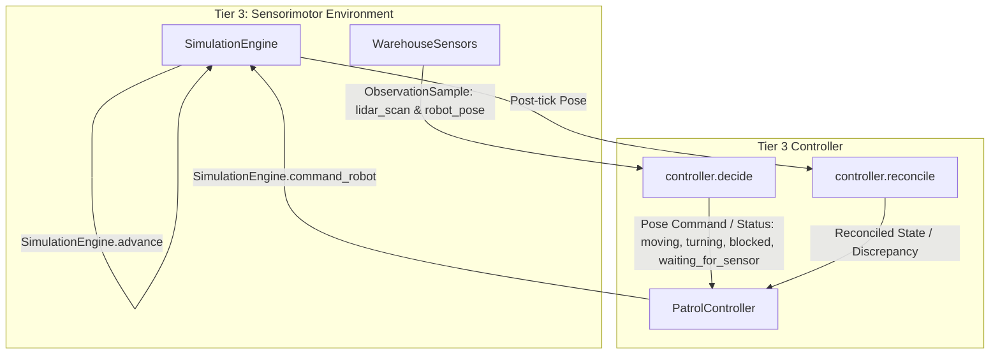

# P2-06 Robot Patrol and Reactive Safety Controller

- **Issue:** [#29: [P2-06] Implement scripted robot patrol and sensor-backed reactive safety controller](https://github.com/dhruvkshah75/groundtruth/issues/29)
- **Pull request:** [#41](https://github.com/dhruvkshah75/groundtruth/pull/41)
- **Branch:** `codex/p2-06-patrol-controller`
- **Lane:** Sensorimotor / Tier 3 Controller
- **Status:** Complete (M2 Integration)
- **Prerequisites:**
  - Issue [#21](https://github.com/dhruvkshah75/groundtruth/issues/21) Contracts (`src/contracts/simulation.py`, `src/contracts/models.py`)
  - Issue [#22](https://github.com/dhruvkshah75/groundtruth/issues/22) Simulation Engine (`src/sensorimotor/simulation_engine.py`)
  - Issue [#23](https://github.com/dhruvkshah75/groundtruth/issues/23) Warehouse Sensors (`src/sensorimotor/warehouse_sensors.py`)

---

## 1. Overview and Architecture

`PatrolController` in `src/sensorimotor/patrol_controller.py` implements the deterministic controller that drives the warehouse robot along its scripted patrol waypoints while enforcing front-LiDAR reactive safety stops and resumption.



### Key Epistemic and Safety Boundaries
- **Strict Evidence Boundary:** Consumes only robot-visible `ObservationSample` envelopes (`robot_pose` and `lidar_scan`). Never inspects `ScenarioDefinition.events`, hidden entities, cart scripts, or complete simulator truth.
- **Two-Step Tick Cycle:** `decide(sim_time_ms, pose, lidar_sample)` proposes at most one cardinal next-tick command $\rightarrow$ the runtime advances the engine $\rightarrow$ `reconcile(post_tick_pose)` verifies actual movement. Out-of-order or duplicate calls raise explicit runtime errors.
- **Pure Deterministic Logic:** Zero wall-clock dependencies, zero real-time sleeping, zero threading locks, and zero LLM calls.

---

## 2. Deterministic Safety & Clearance Policy

### Forward Clearance Between Sensor Scans
LiDAR scans arrive periodically (e.g. every 500 simulation ms), while simulation motion steps advance every 100 ms ($3.0\text{ cm}$ per tick at $30\text{ cm/s}$). The controller conservatively tracks forward odometry since the last scan capture:

1. **Obstacle Hit Detected ($d$ cm):**
   $$\text{remaining\_clearance} = d - \Delta s_{\text{travelled}}$$
   - If $\text{remaining\_clearance} \le \text{stopping\_distance\_cm}$ ($50.0\text{ cm}$): **Stop immediately** (`status="blocked"`).
   - If $\text{remaining\_clearance} > 50.0\text{ cm}$: Motion is allowed up to $\min(\text{tick\_speed}, \text{remaining\_clearance} - 50.0\text{ cm})$.
2. **Clear Scan (No Hit Detected within $R = 200.0\text{ cm}$):**
   $$\text{verified\_clear\_space} = R - \Delta s_{\text{travelled}}$$
   - When verified clear space drops to or below the stopping threshold ($50.0\text{ cm}$), the robot **waits** (`status="waiting_for_sensor"`) rather than blindly assuming infinite clearance.
3. **Cardinal Turns Invalidate Scans:**
   - Rotating at a waypoint immediately clears the active forward LiDAR baseline. The robot will not translate on the new heading until a fresh front scan facing the new direction is acquired.
4. **Sensor Outages & Failures:**
   - Any `ObservationUnavailable` or stale scan ($> 1,000\text{ ms}$) produces `status="waiting_for_sensor"` and halts translation.

---

## 3. Public API & Types

Defined in `src/sensorimotor/patrol_controller.py`:

```python
class PatrolController:
    def __init__(
        self,
        patrol: list[Point],
        config: SimulationConfig,
        *,
        initial_pose: Pose | None = None,
        run_id: UUID | None = None,
        scenario_id: str | None = None,
    ) -> None: ...

    def decide(
        self,
        current_sim_time_ms: int,
        pose_observation: ObservationSample | Pose,
        latest_lidar_sample: ObservationSample | None = None,
    ) -> PatrolDecision: ...

    def reconcile(
        self,
        post_tick_pose_observation: ObservationSample,
    ) -> PatrolReconciliation: ...

    def export_checkpoint(self, current_sim_time_ms: int) -> PatrolCheckpoint: ...
    def restore_checkpoint(
        self,
        checkpoint: PatrolCheckpoint,
        *,
        engine_pose_observation: ObservationSample,
        engine_pending_command: Pose | None = None,
    ) -> None: ...
```

### Result Models
- `PatrolState`: `"moving" | "turning" | "blocked" | "waiting_for_sensor" | "complete" | "stalled"`
- `PatrolDecision`: Contains `status`, optional next `command: Pose`, and structured `record: PatrolDecisionRecord`.
- `PatrolReconciliation`: Reports `executed: bool`, `actual_pose: Pose`, and `discrepancy_reason: str | None`.
- `PatrolCheckpoint`: Versioned JSON-safe state snapshot for pause/resume and replay.

---

## 4. Usage Example

```python
import json
from datetime import UTC, datetime
from pathlib import Path

from src.contracts import MoveEvent, ObservationRequest, Point, ScenarioDefinition
from src.sensorimotor.patrol_controller import PatrolController
from src.sensorimotor.simulation_engine import SimulationEngine
from src.sensorimotor.warehouse_sensors import WarehouseSensors

# Configure a static demonstration cart. Runtime controller inputs remain sensor samples.
data = json.loads(Path("tests/fixtures/phase_two/contracts.json").read_text())
scene_data = data["valid"]["scenario"]
scene_data["events"] = []
cart = next(entity for entity in scene_data["entities"] if entity["entity_id"] == "cart_01")
cart["footprint"] = {"x_cm": 100, "y_cm": 170, "width_cm": 30, "height_cm": 30}
scene = ScenarioDefinition.model_validate(scene_data)
engine = SimulationEngine(scene, epoch_utc=datetime(2026, 1, 1, tzinfo=UTC))
sensors = WarehouseSensors(engine.snapshot)
controller = PatrolController(
    scene.patrol,
    scene.config,
    initial_pose=scene.robot_pose,
    run_id=engine.snapshot().status.run_id,
    scenario_id=scene.scenario_id,
)
pose_request = ObservationRequest(capability="robot_pose")
lidar_request = ObservationRequest(capability="lidar_scan", parameters={"direction": "front"})
engine.play()
for _ in range(10):
    current_time = engine.snapshot().status.sim_time_ms
    decision = controller.decide(
        current_time, sensors.sample(pose_request), sensors.sample(lidar_request)
    )
    if decision.status == "blocked":
        break
    assert decision.command is not None
    engine.command_robot(decision.command)
    engine.advance()
    assert controller.reconcile(sensors.sample(pose_request)).executed
assert decision.status == "blocked"
print("Stopped with observed clearance", decision.record.computed_clearance_cm)

# A presenter input clears the cart. The controller learns via the next scan.
current_time = engine.snapshot().status.sim_time_ms
engine.queue_event(
    MoveEvent(
        kind="move",
        at_ms=current_time + scene.config.step_ms,
        sequence=0,
        entity_id="cart_01",
        to=Point(x_cm=180, y_cm=170),
        duration_ms=scene.config.step_ms,
    )
)
engine.advance()
engine.advance()
current_time = engine.snapshot().status.sim_time_ms
decision = controller.decide(
    current_time, sensors.sample(pose_request), sensors.sample(lidar_request)
)
assert decision.status == "moving"
engine.command_robot(decision.command)

# Future runtime holds one session lock around this paired capture and restore.
engine_checkpoint = engine.export_state()
controller_checkpoint = controller.export_checkpoint(current_time)
restored_engine = SimulationEngine.restore(engine_checkpoint)
restored_sensors = WarehouseSensors(restored_engine.snapshot)
restored_controller = PatrolController(
    scene.patrol,
    scene.config,
    initial_pose=scene.robot_pose,
    run_id=restored_engine.snapshot().status.run_id,
    scenario_id=scene.scenario_id,
)
restored_controller.restore_checkpoint(
    controller_checkpoint,
    engine_pose_observation=restored_sensors.sample(pose_request),
    engine_pending_command=restored_engine.pending_robot_command,
)
# The engine already owns the queued command. Advance and reconcile it once.
restored_engine.advance()
assert restored_controller.reconcile(restored_sensors.sample(pose_request)).executed
print("Resumed and confirmed movement")
```

---

## 5. Verification Commands and Results

```bash
# 1. Unit tests (cardinal segments, clearance, turns, stale/future scans, checkpoints)
uv run --locked pytest tests/unit/sensorimotor/test_patrol_controller.py -v
# Outcome: 37 passed

# 2. Headless integration tests (obstacle approach, stop, clear, resume, outage, playback rates)
uv run --locked pytest tests/integration/test_patrol_integration.py -v
# Outcome: 6 passed (including paired checkpoint and documentation example checks)

# 3. Architectural isolation tests (Tier 3 never imports higher tiers or database logic)
uv run --locked pytest tests/unit/sensorimotor/test_sensorimotor_boundaries.py
# Outcome: 1 passed in 0.39s

# 4. Code formatting and linting
uv run --locked ruff check .
uv run --locked ruff format --check .
# Outcome: All checks passed! Check current command output for the formatted file count.
```

---

## 6. Downstream Integration

- **P2-04 (Observation Ledger):** Stores raw `ObservationSample` envelopes produced during patrol.
- **P2-05 (Temporal Beliefs):** Consumes `ObservationSample` records to update `located_at` parcel beliefs and `route_status` without accessing internal controller variables.
- **P2-07 (Session Runtime & Scheduler):** Drives the fixed-step clock loop, orchestrating `sensors.sample()` $\rightarrow$ `controller.decide()` $\rightarrow$ `engine.command_robot()` $\rightarrow$ `engine.advance()` $\rightarrow$ `controller.reconcile()`.


## Review corrections and runtime handoff

Reconciliation requires a validated successful `robot_pose` sample for the same run,
robot, room and map frame at exactly the decision time plus one configured tick.
Invalid reconciliation preserves the pending command for a valid retry. A bare `Pose`
can be supplied to `decide` by trusted headless callers with explicit run identity.
Runtime integrations use timestamped pose samples, as in the example. `PoseMeasurement`
without room/frame context is rejected.

Forward clearance is usable only along the captured heading and ray with nonnegative
forward displacement. Lateral displacement, reverse displacement, an old acquisition,
or invalid evidence causes a wait. A stalled command or outage requires a new usable
sample captured at or after the failed tick. Returning from a turn also requires a
post-turn acquisition. Public waypoints, decisions, reconciliation results and
checkpoints are detached copies.

Checkpoint schema version 2 includes the complete LiDAR acquisition, static patrol,
configuration, exact target progress, pending decision time and fresh-acquisition gate.
Earlier version 1 controller checkpoints must be restarted with fresh observations.
Restore validates the supplied patrol/configuration/scenario and paired engine pose,
time, run and pending command before changing controller state. Playback rate may
change without changing the physical configuration. The future runtime owns the
session lock and captures/restores both engine and controller under it. It supplies
`SimulationEngine.pending_robot_command` and a pose sample from the restored engine.
A restored pending command is reconciled after its tick, while a duplicate decision
is rejected. This handoff carries robot-visible evidence and execution metadata.

Full verification passed with 553 tests, including 43 patrol-focused tests, with localhost access and developer `.env` loading disabled. Lint, formatting, Python compilation, frontend build, graph checks and inspector display checks passed.
