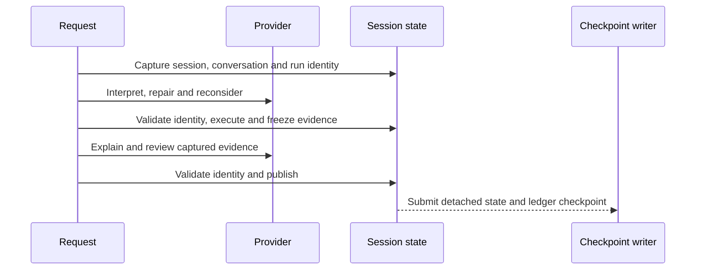

# Session simulation runtime (P2-07)

[Issue #31](https://github.com/dhruvkshah75/groundtruth/issues/31) · [Implementation PR #43](https://github.com/dhruvkshah75/groundtruth/pull/43)

| Prerequisite | Merged commit | Interface used |
| --- | --- | --- |
| [#21](https://github.com/dhruvkshah75/groundtruth/issues/21) | `27afc24` | `ScenarioDefinition`, `SimulationControl`, `ObservationSample` |
| [#22](https://github.com/dhruvkshah75/groundtruth/issues/22) | `7c76507` | `SimulationEngine.advance`, `step`, `export_state`, `restore` |
| [#23](https://github.com/dhruvkshah75/groundtruth/issues/23) | `6280348` | `WarehouseSensors.sample` and its sequence allocator |
| [#24](https://github.com/dhruvkshah75/groundtruth/issues/24) | `2581404` | `MemoryRepository` observation ledger and SQLite image |
| [#27](https://github.com/dhruvkshah75/groundtruth/issues/27) | `9add3df` | `TemporalBeliefIngestionService.ingest_sample` |
| [#29](https://github.com/dhruvkshah75/groundtruth/issues/29) | `3849789` | `PatrolController.decide`, `reconcile`, and paired checkpoint validation |

## Service interface

`AgentService(config=None, store=None, *, now=monotonic, background=True)` owns one
warehouse runtime per loaded session. The service starts one scheduler when the first
warehouse is loaded or restored. Legacy A/B sessions retain their static behavior.
The scheduler wakes every 50 wall milliseconds and only pumps due simulation work.
It skips busy session locks and catches up on subsequent pumps, subject to the
per-pump tick limit, so another session can continue advancing.

- `load_simulation(session_id, scenario, *, epoch_utc=None) -> SessionSimulationStatus`
  starts a new paused run, with one initial sensor batch and a fresh run ID.
- `control_simulation(session_id, SimulationControl(...)) -> SessionSimulationStatus`
  supports play, pause, step, set rate and reset. Warehouse reset loads the same
  scenario with a fresh run ID and retains the selected rate.
- `read_simulation(session_id) -> SessionSimulationRead` returns typed status, a detached
  audience snapshot, and provider readiness. A read records viewer activity and does
  not advance simulation time.
- `pump()` runs one scheduling pass. Use `background=False` and a fake monotonic
  clock for deterministic tests.
- `shutdown()` stops the scheduler, drains pending checkpoint work, and closes the
  owned agent repositories. The server closes its session store after service shutdown.

```python
import json
from pathlib import Path
from uuid import uuid4

from src.contracts.simulation import ScenarioDefinition, SimulationControl
from src.providers import ProviderConfig
from src.web.service import AgentService

fixture = Path("tests/fixtures/phase_two/contracts.json")
scenario = ScenarioDefinition.model_validate(json.loads(fixture.read_text())["valid"]["scenario"])
clock = [0.0]
session_id = str(uuid4())
service = AgentService(
    ProviderConfig(mode="rule-based", api_key=None), now=lambda: clock[0], background=False
)
try:
    service.load_simulation(session_id, scenario)
    service.control_simulation(session_id, SimulationControl(action="play"))
    clock[0] = 1.0
    service.pump()
    assert service.read_simulation(session_id)["status"]["sim_time_ms"] == 500
finally:
    service.shutdown()
```

## Timing, sensing and safety

The clock multiplies monotonic wall time by the rate in effect during that interval.
Rate changes preserve accumulated time. Paused wall time adds no debt. A pump runs
at most ten fixed ticks and reports unprocessed simulation milliseconds in
`backlog_ms`. A manual step runs one fixed tick while paused. Warehouse completion
stops automatic ticks and acquisitions.

The initial batch runs at simulation time zero in this order: pose, front LiDAR,
broad camera, ambient light. Each tick uses the last robot-visible pose and forward
LiDAR for its patrol decision, queues at most one command, advances physics, and
samples the post-tick pose. A commanded tick reconciles motion. A stationary tick
validates the unchanged pose and advances the controller's checkpoint time. A
500 ms boundary reuses that pose sample and acquires LiDAR, camera and light in the
same state-lock interval. After a turn, the controller waits for a forward scan on
the new heading before translating.

Periodic and question-triggered samples share one allocator and the same ingestion
service. Empty successful scans and unavailable samples are distinct ledger entries.
The warehouse route evaluation leaves belief writes to temporal ingestion. The LLM
receives robot-visible evidence from the deterministic query path. The audience
snapshot and future script stay outside the provider payload.

## Request and lock lifecycle



An ask holds the per-session request mutex across its provider phases to serialize
mutable provider trace fields. It briefly takes the session state lock to capture
identity, execute approved operations, and publish. Provider calls, response
encoding, and persistence waits run outside the state lock. A warehouse response
includes `simulation_evidence.run_id`, `sim_time_ms`, and `request_id` for its
capture. The current service snapshot can advance while explanation is in progress.

Registry lookup copies references under the registry lock and releases it before
acquiring a session lock. The separate lifecycle lock serializes creation and deletion
of registry entries. No session operation acquires that lifecycle lock. The scheduler
and the checkpoint writer are joined without the registry or session locks. Shutdown
and deletion retire the session so a provider that returns late cannot touch its ledger.

New chat invalidates the conversation and preserves the warehouse. Preset replacement,
reset, deletion, and shutdown invalidate earlier requests. Retiring the session object
also protects delete and recreate with the same UUID. State reads, asks and controls
count as viewer activity. After 60 wall seconds without activity, a running session
pauses and checkpoints. Automatic ticks, writes and provider completions do not
extend that timer.

## Checkpoint and recovery

A version 1 runtime checkpoint is an additive key in the legacy session JSON. It
contains the validated engine replay checkpoint, paired controller checkpoint,
latest patrol evidence, next sequence, and unprocessed clock time. The existing
SQLite row commits that JSON and its matching memory image together.

Capture and queue submission are ordered under the session lock. One FIFO writer
per service performs SQLite writes and deletions, so an older capture cannot commit
after a newer one or recreate a deleted session. Dirty runs checkpoint at one wall
second intervals, with immediate captures for controls and lifecycle changes.
A writer failure pauses the affected run with a persistence diagnostic.

Restore validates engine replay, controller pairing, and saved evidence against the
ledger. Active runs restore paused and anchor wall time to the new process. An
existing queued engine command is reconciled once before the controller issues
another. The runtime acquires fresh forward evidence before a new motion decision
on a restored run. Completed runs retain their terminal state. Legacy sessions
restore without creating a warehouse. An invalid checkpoint surfaces a recoverable
load error and keeps the saved row available until reset, replacement, or deletion.
An internal ingestion or tick failure pauses the run and requires a reload or reset.

## Verification and downstream use

- Clock and runtime checkpoints are exercised by
  `uv run --locked pytest -q tests/unit/test_simulation_clock.py tests/integration/test_simulation_runtime.py tests/integration/test_session_simulation.py`.
- The focused suite passed 24 tests. It covers the corrected warehouse replay,
  blocked interpretation, synthesis and review, stale publication, serialization,
  pending-command restore, corrupt checkpoints, inactivity, and failed or delayed writes.
- The locked full suite passed 577 tests with localhost access. The test process
  bypassed the repository's default developer `.env` loading so tests could
  select their own provider configuration. The headless example above also ran successfully.
- Repository-wide Ruff lint and formatting checks passed.

P2-08 can use the capture metadata and run-scoped ledger for temporal queries.
P2-09 can expose the service controls and separate audience snapshot as HTTP
endpoints. P2-12 can use the headless pump for repeatable replay. The existing chat
HTTP routes remain the entry points for A/B and question handling.
