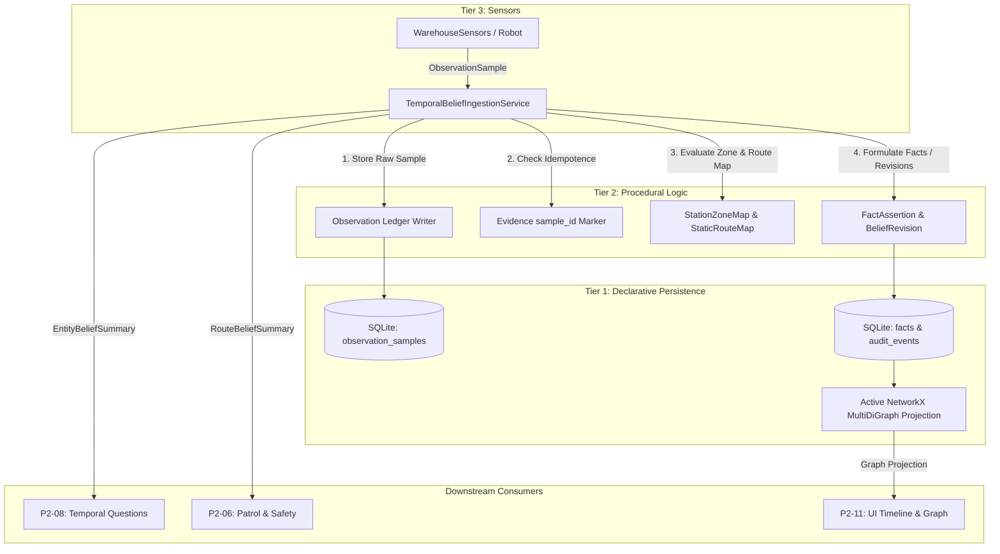

# Temporal Belief Ingestion and Epistemic Summaries (P2-05)

- **Issue:** [#27: [P2-05] Ingest sensor observations into time-aware beliefs and auditable revisions](https://github.com/dhruvkshah75/groundtruth/issues/27)
- **Branch:** `fix/issue-27`
- **Lane:** Temporal Memory / Tier 2 Integration
- **Status:** Complete (M2 Integration)
- **Prerequisites:**
  - Issue [#21](https://github.com/dhruvkshah75/groundtruth/issues/21) Contracts (`src/contracts/simulation.py`, `src/contracts/models.py`)
  - Issue [#22](https://github.com/dhruvkshah75/groundtruth/issues/22) Simulation Engine (`src/sensorimotor/simulation_engine.py`)
  - Issue [#23](https://github.com/dhruvkshah75/groundtruth/issues/23) Warehouse Sensors (`src/sensorimotor/warehouse_sensors.py`)
  - Issue [#24](https://github.com/dhruvkshah75/groundtruth/issues/24) Observation Ledger (`src/declarative/memory_repository.py`)
  - Tier 1 Declarative Persistence & Projection (`src/declarative/active_graph.py`)

---

## 1. Overview and System Context

The **Temporal Belief Ingestion Service** (`TemporalBeliefIngestionService` in `src/procedural/temporal_belief_ingestion.py`) serves as the Tier 2 bridge between raw timestamped sensor acquisitions and GroundTruth's explainable belief ledger and active knowledge graph.



### Strict Tier 2 Boundaries
As mandated by GroundTruth's three-tier epistemic architecture:
- **No Concrete Tier Imports:** `temporal_belief_ingestion.py` imports no SQLite, NetworkX, `src.declarative`, `src.sensorimotor`, or LLM provider code.
- **Protocol-Driven Interaction:** Consumes `FactRepositoryProtocol`, `ObservationLedgerWriter`, and `ObservationLedgerReader` protocols. Concrete instances (`MemoryRepository`, `GraphSyncedRepository`) are wired at the composition boundary.
- **Evidence Purity:** Never accesses hidden world state (`SimulationSnapshot.entities`, `ScenarioDefinition`, future events) or presenter playback pacing. All reasoning is derived exclusively from validated `ObservationSample` envelopes and static declarative maps.

---

## 2. Deterministic Observation-to-Belief Policies

### A. Station Zone Membership & Location Policy
Camera detections report an object ID, apparent color, bounding box, and coordinate point in map centimeters.
1. **Static Zone Mapping:** Station membership is resolved deterministically against an explicitly configured `StationZoneMap`. Boundaries are inclusive (`x_min <= x <= x_max` and `y_min <= y <= y_max`).
2. **Ambiguity and Boundary Rules:**
   - **Matched (1 zone):** Creates or updates the `located_at` belief for the parcel.
   - **Unmapped (0 zones):** Retains the raw sample in the observation ledger, but creates no station fact. Marks `status="unmapped"` and sets `uncertainty=True`.
   - **Ambiguous (>1 overlapping zones):** Creates no fact. Marks `status="ambiguous"` and sets `uncertainty=True`.
3. **Sub-Zone Jitter & Repeated Sightings:** Repeated sightings confirming the same zone update last-seen and verification metadata without creating duplicate active facts or revision audit events. Coordinate changes within the same station zone do not inflate SQLite or NetworkX.
4. **Inter-Zone Relocation Revisions:** When a newer comparable observation maps the entity to a different station zone, the service executes an atomic Tier 1 belief revision linking predecessor, successor, and a justified audit explanation.

### B. Front LiDAR and Route Status Policy
1. **Pose and Corridor Matching:** Front LiDAR observations are mapped to a named route only when the robot's pose matches the segment geometry within corridor tolerances and the robot's direction matches the route's heading.
2. **Ambiguity Gate:** If zero routes match (e.g. facing perpendicular to route or in unmapped area) or multiple routes match, the observation is retained in the ledger, no route fact is altered, and `uncertainty=True` is returned.
3. **Blocked $\rightarrow$ Clear Auditable Revisions:** When front LiDAR detects an obstacle, route status is revised to `blocked`. When a subsequent scan shows a clear path, route status is atomically revised to `clear`, maintaining a verifiable audit chain.

### C. Clock Semantics, Freshness, and Visibility
1. **Simulation-Time Freshness:** Freshness is evaluated using the run's current simulation time (`sim_time_ms`), **never wall-clock receipt time or playback rate**. Default freshness limit is 1,000 simulation ms:
   - $\text{age} \le 1,000 \text{ ms}$: `fresh`, `verified`.
   - $\text{age} > 1,000 \text{ ms}$: `stale`, `last_seen`.
2. **Future-Dated Protection:** Queries or samples where `sim_time_ms` is in the future are rejected as unverifiable. Age is clamped at $\ge 0$ and never assigned a negative value.
3. **Broad Scan Non-Detection (Omission) vs. Outage:**
   - **Healthy Broad Scan Lacking Entity:** Marks entity `visibility="not_currently_visible"` and `verification_status="last_seen"`. Historical location belief is preserved; no disappearance or movement fact is fabricated.
   - **Sensor Outage (`ObservationUnavailable`):** Marks verification as `unavailable`, preserving prior sighting without asserting negative visibility.
   - **Targeted Scan Scope:** A targeted scan for parcel A provides evidence only for parcel A; it never marks parcel B invisible.

---

## 3. Reliability, Idempotency, and Concurrency

### Recoverable Ingestion Sequence
The ingestion lifecycle spans two distinct storage boundaries:
1. **Step 1 (Raw Sample Persistence):** Persists the validated `ObservationSample` via `ObservationLedgerWriter.record_observation_sample()`.
2. **Step 2 (Idempotence Marker Check):** Inspects Tier 1 facts using `get_facts_by_sample_id(sample.sample_id)`.
3. **Step 3 (Belief Mutation):** Executes `record_fact()` or `record_revision()`. The durable fact evidence dict contains `"sample_id": str(sample.sample_id)` as the idempotence marker.

### Concurrency and Partial Failure Recovery
- **Duplicate Sample Replay:** Re-ingesting an already-ingested sample detects the existing `sample_id` marker and returns `status="duplicate_ignored"` without creating duplicate facts, revisions, or audit events.
- **Crash Recovery:** If a crash or error occurs after Step 1 but before Step 3, retrying ingestion safely completes the fact/revision without duplicating the raw sample row.
- **Thread Synchronization:** All ingestion and summary queries are synchronized via an internal re-entrant lock (`threading.RLock()`), satisfying multi-threaded session execution and avoiding SQLite interface misuse.

---

## 4. Public API & Type Definitions

Defined in `src/procedural/temporal_belief_ingestion.py`:

```python
class TemporalBeliefIngestionService:
    def __init__(
        self,
        fact_repository: FactRepositoryProtocol,
        observation_ledger: ObservationLedgerWriter | None = None,
        zone_map: StationZoneMap | None = None,
        route_map: StaticRouteMap | None = None,
        config: IngestionConfig | None = None,
    ) -> None: ...

    def ingest_sample(
        self,
        sample: ObservationSample,
        current_sim_time_ms: int | None = None,
    ) -> IngestionResult: ...

    def get_entity_belief_summary(
        self,
        run_id: UUID,
        entity_id: str,
        current_sim_time_ms: int,
    ) -> EntityBeliefSummary: ...

    def get_route_belief_summary(
        self,
        run_id: UUID,
        route_id: str,
        current_sim_time_ms: int,
    ) -> RouteBeliefSummary: ...
```

### Core Summary Contracts
- **`IngestionResult`:** Contains `status`, `stored_sample`, `facts_created`, `revisions_created`, `entity_summaries`, `route_summary`, and `uncertainty` flags.
- **`EntityBeliefSummary`:** Detailed report containing `supported_location`, `active_fact_id`, `last_positive_sighting`, `latest_sensor_attempt`, `verification_status` (`verified` | `last_seen` | `unverified` | `unavailable`), `visibility` (`currently_visible` | `not_currently_visible` | `unknown`), `freshness` (`fresh` | `stale` | `future_dated` | `unverified`), and exact observed coordinates.
- **`RouteBeliefSummary`:** Reports `status` (`clear` | `blocked`), supporting LiDAR samples, nearest distance, verification, and freshness.

---

## 5. Usage Example

```python
from src.declarative.active_graph import GraphSyncedRepository
from src.declarative.memory_repository import MemoryRepository
from src.procedural.temporal_belief_ingestion import TemporalBeliefIngestionService

# 1. Wire repositories at composition boundary
repo = MemoryRepository(":memory:")
synced_repo = GraphSyncedRepository.create(repo)
service = TemporalBeliefIngestionService(synced_repo, repo)

# 2. Ingest sensor sample
result = service.ingest_sample(camera_sample)
print(f"Status: {result.status}, Facts created: {len(result.facts_created)}")

# 3. Query epistemic summary at simulation time 500 ms
summary = service.get_entity_belief_summary(
    run_id=camera_sample.run_id,
    entity_id="parcel_01",
    current_sim_time_ms=500,
)
print(
    f"Location: {summary.supported_location}, Visibility: {summary.visibility}, Freshness: {summary.freshness}"
)

# 4. Active knowledge graph automatically reflects the SQLite belief
graph = synced_repo.get_graph()
print("Graph edges:", list(graph.edges(data=True)))
```

---

## 6. Verification and Checkpoints

All acceptance criteria are covered by automated unit and integration tests.

### Checkpoint Commands and Results
```bash
# 1. Procedural architectural boundaries
.venv/bin/pytest tests/unit/procedural/test_procedural_boundaries.py
# Outcome: 1 passed in 0.01s (zero forbidden tier or provider imports)

# 2. Temporal belief unit tests (protocol fakes)
.venv/bin/pytest tests/unit/procedural/test_temporal_belief_ingestion.py -v
# Outcome: 14 passed in 0.15s

# 3. Integration tests with SQLite, NetworkX, and Phase 2 fixtures
.venv/bin/pytest tests/integration/test_temporal_belief_ingestion.py -v
# Outcome: 5 passed in 0.30s

# 4. Code quality and formatting checks
.venv/bin/ruff format --check .
# Outcome: 123 files already formatted
.venv/bin/ruff check .
# Outcome: All checks passed!
```

---

## 7. Downstream Integration

- **P2-06 (Patrol and Safety):** Consumes `RouteBeliefSummary` to gate motion and stopping logic on route availability.
- **P2-07 (Session Runtime):** Coordinates periodic simulation step updates, invoking `ingest_sample()` on each sensor polling tick.
- **P2-08 (Temporal Questions):** Uses `get_entity_belief_summary()` and `get_route_belief_summary()` to synthesize natural-language answers distinguishing "last seen" from currently verified locations.
- **P2-11 (Timeline & Presentation):** Renders epistemic visibility states and audit trails directly from the SQLite evidence ledger and synchronized NetworkX projection.
