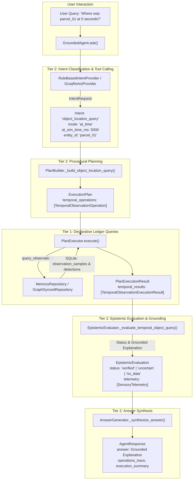

# Temporal Object Questions and Evidence-Grounded Explanations (P2-08)

- **Issue:** [#32: [P2-08] Add temporal object questions and evidence-grounded explanations](https://github.com/dhruvkshah75/groundtruth/issues/32)
- **Pull Request:** `feat/p208`
- **Lane:** Procedural Reasoning / Tier 2 Epistemic Integration & Natural Language QA
- **Status:** Complete
- **Prerequisites:**
  - Issue [#21](https://github.com/dhruvkshah75/groundtruth/issues/21) Shared Simulation Contracts (`src/contracts/simulation.py`, `src/contracts/models.py`)
  - Issue [#24](https://github.com/dhruvkshah75/groundtruth/issues/24) Observation Ledger & Temporal Queries (`src/declarative/memory_repository.py`)
  - Issue [#27](https://github.com/dhruvkshah75/groundtruth/issues/27) Temporal Belief Ingestion (`src/procedural/temporal_belief_ingestion.py`)
  - Issue [#31](https://github.com/dhruvkshah75/groundtruth/issues/31) Deterministic Tool-Calling & ReAct Grounding (`src/providers/`)

---

## 1. Overview and Architecture

The **Temporal Object Questions and Explanations** milestone introduces an additive, non-breaking intent and execution pipeline that enables GroundTruth to answer time-aware questions about physical entities in the simulated warehouse environment.

Unlike standard LLM agents that hallucinate intermediate coordinates, invent unrecorded movements, or smooth over sensor dropouts, GroundTruth's procedural epistemic architecture enforces **strict physical grounding**:
1. All location statements cite explicit, tamper-evident observation ledger evidence (`sample_id`, `sim_time_ms`, coordinate points, observer robot, camera state).
2. The agent refuses to interpolate between discrete sightings.
3. Unobserved intervals, sensor outages (`ObservationUnavailable`), and future-dated queries are explicitly acknowledged as uncertain.
4. When physical movement between stations is detected, transitions are audited alongside a mandatory physical transit caveat.



### Strict Three-Tier Separation
- **Tier 1 (Declarative):** Persistence of immutable observation envelopes and normalized detections in SQLite; indexed by `run_id`, `sim_time_ms`, `sensor_type`, and `entity_id`.
- **Tier 2 (Procedural):** Intent parsing, plan construction, deterministic epistemic evaluation, and synthesis guards. Procedural components consume memory protocols without concrete SQLite imports.
- **Tier 3 (Sensorimotor):** Simulation clock and warehouse sensors generating validated observation envelopes (`StoredObservationSample`, `CameraScan`).

---

## 2. The Five Temporal Query Modes

The `object_location_query` intent supports five distinct temporal analysis modes:

| Mode | Natural Language Prompt Examples | Primary Grounding Ledger Query | Output & Truth Value |
| :--- | :--- | :--- | :--- |
| `current` | *"Where is parcel_01 right now?"*, *"What is the current position of blue box?"* | Latest camera scan and latest positive sighting of entity | Returns verified coordinates if currently detected; reports uncertainty if camera has outage or scan lacks entity. Falls back to stored memory fact if no camera scans exist. |
| `last_seen` | *"When and where was parcel_01 last seen?"*, *"Where was the red parcel last spotted?"* | Most recent positive sighting sample in the run | Cites last confirmed `sim_time_ms`, coordinates $(x, y)$, observer robot, sample age in ms, and subsequent scan verification context. |
| `at_time` | *"Where was parcel_01 at 5 seconds?"*, *"Check location of parcel_02 at 12000 ms"* | Latest sighting with `sim_time_ms <= at_sim_time_ms` + run horizon | Strictly validates `at_sim_time_ms >= 0`. Rejects future queries beyond run horizon. Reports exact observation at or prior to target time. Prohibits position interpolation. |
| `history` | *"Show me the history of parcel_01"*, *"List all sightings of box_02"* | Chronological list of positive detections across entire run | Formats chronological timeline of every sighting, timestamp, coordinates, observer robot, and sample ID. |
| `changes` | *"Has parcel_01 moved?"*, *"Where was parcel_01 previously?"*, *"Show movements of parcel_02"* | Sequential station-zone transitions and coordinate shifts | Detects station relocations and coordinate changes. Formats transition intervals, reasons from belief revision audit trail, and appends the mandatory transit caveat. |

---

## 3. Epistemic Grounding & Anti-Interpolation Semantics

### A. Strict Anti-Interpolation Principle
When evaluating an `at_time` query for a timestamp $T$ between two observations ($t_1 < T < t_2$), or after an observation ($t_1 \le T$ with no later observation):
- The agent reports the last verified sighting at or prior to $T$ ($t_1$).
- The agent explicitly states: *"No camera observation recorded at exactly T ms. Position at T ms cannot be interpolated."*
- Intermediate coordinates between sample points are **never mathematically interpolated or hallucinated**.

### B. Time Semantics & Future-Dated Queries
- Target timestamps must be non-negative (`at_sim_time_ms >= 0`). Requests with negative timestamps fail schema validation (`ValueError`).
- If $T > t_{\text{latest\_run}}$, the evaluation returns `status="uncertain"`:
  *"The requested simulation time T ms is in the future relative to available observation ledger evidence (latest recorded: ... ms). Location cannot be verified."*
- Simulation time is strictly independent of wall-clock time and playback rate.

### C. Sensor Outage Resilience
When a sensor outage occurs (`ObservationUnavailable`), the failure envelope is preserved in the observation ledger:
- In `current` mode: The agent does not fabricate absence or claim the parcel disappeared; it reports: *"Current location cannot be freshly verified because the camera reported an outage at simulation time T ms (outage_reason). Last confirmed sighting was at ... ms."*
- In `last_seen` mode: The last confirmed sighting is returned with subsequent outage context noted in the verification summary.

### D. Mandatory Physical Transit Caveat
Whenever location transitions between distinct stations or coordinates are detected in `changes` mode, the explanation concludes with GroundTruth's mandatory physical transit disclaimer:
> *"Note: Two sightings at distinct locations demonstrate that a transition occurred, but do not prove continuous path, exact transit duration, or physical relocation cause."*

### E. Entity Resolution and Ambiguity Clarification
- Natural language aliases (e.g., *"red parcel"*, *"blue box"*) are resolved using known graph facts.
- If an alias is ambiguous (e.g., multiple parcels share color or descriptor) or cannot be resolved, the agent does not guess an arbitrary entity. It returns a clarification request (`status="requires_clarification"`).
- Out-of-scope requests (e.g., controlling robots or predicting future routes) are gracefully rejected.

---

## 4. End-to-End Implementation Contracts

### Contract Additions (`src/contracts/models.py`)
```python
IntentType = Literal[
    ...,
    "object_location_query",
]

TemporalQueryMode = Literal[
    "current",
    "last_seen",
    "at_time",
    "history",
    "changes",
]


class IntentRequest(BaseModel):
    intent: IntentType
    entity_id: str | None = None
    mode: TemporalQueryMode = "current"
    at_sim_time_ms: int | None = None
    run_id: UUID | None = None
    # ...
```

### Tool Definition (`src/providers/tools.py`)
The tool `object_location_query` is exposed to LLM function calling with detailed descriptions of all 5 modes, required entity arguments, and non-negative integer parameter validation.

### Procedural Pipeline
1. **`RuleBasedIntentProvider`** (`src/procedural/rule_based_provider.py`):
   - Regex-free and regex-powered classification for temporal modes, time units (`seconds`, `s`, `ms`), and entity aliases.
   - Extracts `mode` and `at_sim_time_ms`.
2. **`PlanBuilder`** (`src/procedural/plan_builder.py`):
   - Emits `TemporalObservationOperation` instances configured for the specific mode.
   - For `at_time` mode, fetches both historical sightings up to $T$ and the run horizon to evaluate future boundaries.
3. **`PlanExecutor`** (`src/procedural/plan_executor.py`):
   - Queries `self._memory.query_observations(...)` to retrieve stored observation envelopes and detections.
   - Returns typed `TemporalObservationExecutionResult`.
4. **`EpistemicEvaluator`** (`src/procedural/epistemic_evaluator.py`):
   - Reconstructs physical timelines, checks camera outages, verifies coordinates, audits revision trails for station changes, and formats tamper-evident explanations.
5. **`GroundedAgent`** (`src/agent.py`):
   - Coordinates intent proposal, plan building, execution, evaluation, and answer delivery with complete operation traces.

---

## 5. Verification and Test Results

The implementation is verified by 33 targeted unit and integration tests in [`tests/unit/procedural/test_temporal_questions.py`](file:///c:/Users/rajat/groundtruth/tests/unit/procedural/test_temporal_questions.py), alongside GroundTruth's complete regression suite.

### Test Categories
1. **Mode-Specific Grounding Tests:**
   - `test_current_mode_fresh_observation`: Confirms verified status with exact coordinates.
   - `test_current_mode_sensor_outage`: Verifies uncertainty on camera outage.
   - `test_current_mode_subsequent_scan_omission`: Verifies uncertainty when later scan omits entity.
   - `test_current_mode_fallback_to_stored_belief`: Tests fallback when no camera scans exist.
   - `test_last_seen_mode_reports_age_and_context`: Validates timestamp, coordinates, age calculation, and subsequent scan status.
   - `test_at_time_mode_exact_match`: Verifies sighting at requested time.
   - `test_at_time_mode_preceding_sighting_no_interpolation`: Proves anti-interpolation guarantee.
   - `test_at_time_mode_future_unrecorded_time`: Rejects queries beyond recorded horizon.
   - `test_history_mode_chronological_list`: Validates full chronological detection sequence.
   - `test_changes_mode_relocation_audit`: Verifies station transition detection with revision audit reasons and mandatory transit caveat.
   - `test_changes_mode_no_movement`: Verifies stationary object explanation.
2. **Robustness & Edge Cases:**
   - `test_negative_simulation_time_rejected`: Validates Pydantic schema validation.
   - `test_alias_ambiguity_returns_clarification`: Validates entity resolution safety.
   - `test_adversarial_synthesis_falls_back_to_deterministic_grounding`: Confirms deterministic defense against LLM hallucination.
   - `test_simultaneous_observations_tie_breaking`: Tests deterministic ordering on matching timestamps.
   - `test_prompt_dataset_coverage`: Executes natural language prompts across all 5 modes end-to-end.

### Verification Run
```text
uv run --locked pytest tests/unit/procedural/test_temporal_questions.py -v
33 passed in 1.66s

uv run --locked pytest -q
586 passed in 13.79s

uv run --locked ruff check .
All checks passed!

uv run --locked ruff format --check .
130 files already formatted
```
